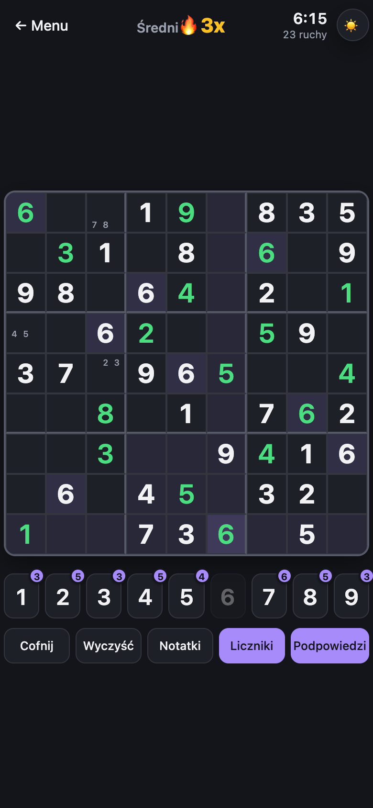
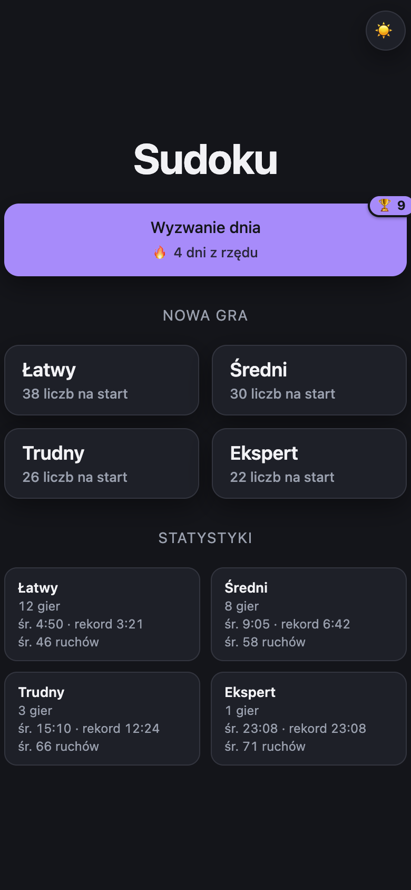

# Sudoku

A Sudoku game built as a PWA (SPA, game state saved in `localStorage`, installable on the home screen).

- Puzzle generator with a guaranteed unique solution (backtracking + uniqueness check), 4 difficulty levels.
- A new-game screen and a game screen (notes/pencil marks, highlighting, undo, remaining-digit counters, optional color hints, sounds).
- The saved state lets you resume an unfinished game after closing the browser/app.

## Why this exists

I built this for my friends. Many of them had free Sudoku apps installed that made money by selling their data. This is a simple alternative: no ads, no accounts, no analytics and no trackers. The app makes no network requests of its own. Your games and stats stay in your browser's `localStorage` on your device and never leave it.

## Demo

<p align="center">
  
  &nbsp;
  
</p>

Play it live in the browser:

- **GitHub Pages:** https://kacperthecat.github.io/sudoku/
- **Vercel:** https://sudoku-eta-navy.vercel.app

Open either link on your phone and use *Add to Home Screen* to install it as an app. It works offline once loaded.

## Development

```bash
npm install
npm run dev
```

## Build

```bash
npm run build
npm run preview
```

## Tests

```bash
npm run test        # single run
npm run test:watch  # watch mode
```

Unit tests (Vitest) cover the pure logic: the Sudoku generator/solver, game state mutations, ripple animations and `localStorage` persistence. There are no React component tests.

## Deploy

A push to the `main` branch triggers `.github/workflows/deploy.yml`, which builds the project and publishes it to GitHub Pages (requires enabling it in the repo settings: **Settings → Pages → Source: GitHub Actions**). Vercel is connected in parallel (through the Vercel UI).

## Documentation

The docs are written in Polish.

- [`docs/LOGIKA_BIZNESOWA.md`](docs/LOGIKA_BIZNESOWA.md) — game rules and app behavior from the player's perspective.
- [`docs/ARCHITEKTURA.md`](docs/ARCHITEKTURA.md) — code structure, patterns, technical decisions.
